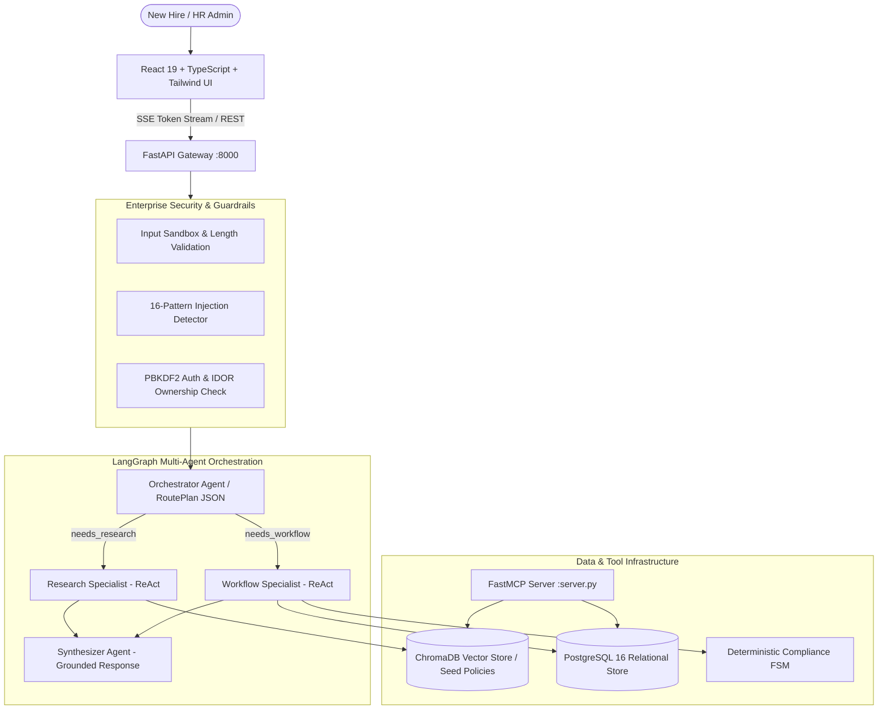

# Aarambh-AI — Autonomous HR Onboarding Agent

[](https://github.com/monish-r/Employee-Onboarding/actions)
[](https://opensource.org/licenses/MIT)
[](https://www.python.org/)
[](https://react.dev/)
[](https://github.com/langchain-ai/langgraph)

An enterprise-grade autonomous HR onboarding multi-agent system designed for the **Dayforce AI Challenge**. 

**Aarambh-AI** transforms employee onboarding from a passive question-and-answer chat interface into an **active, autonomous workflow system**: it answers policy questions with Markdown source citations, proactively generates personalized 30-day onboarding checklists, handles equipment provisioning with Human-in-the-Loop approval cards, enforces regulatory compliance (I-9, EPF, GDPR), and tracks milestone readiness.

---

## The Problem

New hires are bombarded with fragmented information across IT, payroll, benefits, and team guidelines. Simultaneously, HR and IT administrators manually track task checklists, equipment delivery, and statutory document compliance across jurisdictions.

- **Standard chatbots fail here**: They can answer basic questions, but they cannot verify credentials, track dependencies, enforce regulatory gates, or safely execute state-changing actions.
- **Aarambh-AI bridges the gap**: Combining strict **deterministic compliance gates** with an autonomous **4-node LangGraph multi-agent system**.

---

## Architecture



---

## Evaluation Rubric & Compliance

Built strictly against Dayforce's AI evaluation framework:

| Evaluation Category | Weight | How Aarambh-AI Satisfies It |
|---|:---:|---|
| **1. Product Value** | **25%** | **Clear user problem**: Alleviates new hire cognitive overload and HR administrative bottleneck.<br>**Practical workflow**: Day 1 orientation, dynamic 30-day plan, payroll direct deposit, equipment provisioning, document e-signing (Form I-9, EPF Form 11, NDA).<br>**Measurable outcomes**: Deterministic **Readiness Score** (`calculate_readiness()`), real-time completion gauge, and Control Tower dashboard (`/dashboard`). |
| **2. Harness Engineering** | **25%** | **Structured contracts**: OpenAPI 3.0 specification (`docs/openapi.json`), Pydantic v2 schemas.<br>**Validation & guardrails**: Input length caps, PII account masking, sliding-window rate limiting.<br>**Human oversight (HITL)**: Two-way Action Proposal Cards for equipment requests and check-in bookings requiring user confirmation.<br>**Deterministic gates**: Code-level compliance FSM (`shared/compliance.py`) blocking production access until Security Training is completed.<br>**Injection defense**: Input sandboxing (`<user_input>`), write-tool blocking on suspected prompts, canned hijack output detection. |
| **3. LLM Implementation** | **20%** | **Appropriate grounding**: RAG retrieval over approved policies (`employee-handbook.md`, `location-india.md`, `it-setup.md`) with UI citation badges.<br>**Prompt design**: Multi-agent separation (Orchestrator, Research, Workflow, Synthesizer) with persona-aware context injection.<br>**Model flexibility**: Seamless support for Google Gemini (`gemini-1.5-flash`), open-weight models via Groq (Meta Llama 3.1 8B), Ollama, and OpenAI (`gpt-4o-mini`). |
| **4. Engineering Quality** | **15%** | **Testing**: 34 unit and contract tests in `tests/` (100% pass rate).<br>**Eval suite**: 36 golden evaluation scenarios (`evals/scenarios.yaml`) + DeepEval LLM-as-judge.<br>**API design**: Clean RESTful architecture, SSE real-time streaming, and FastMCP protocol integration.<br>**Observability**: Relational `audit_logs`, `agent_executions` latency tracking, and token accounting.<br>**Documentation**: Exhaustive guides in `docs/` (`SECURITY.md`, `MULTI-AGENT.md`, `EVALS.md`, `RUN.md`). |
| **5. Demo Recording** | **15%** | **Demo readiness**: Pre-seeded demo employee (Alex Chen, Software Engineer, Day 1) with switchable personas (FTE, Contractor, Intern; India, USA, Finland).<br>**2-minute demo flow**: Policy Q&A with citations -> task creation -> HITL action card confirmation -> compliance prerequisite blocking -> dashboard control tower view. |

---

## Multi-Model & Open-Weight Support

Aarambh-AI runs on frontier or open-weight models with zero code modifications:

- **Google Gemini**: Set `GEMINI_API_KEY` and `LLM_MODEL=gemini-1.5-flash` (or `gemini-2.0-flash`).
- **Meta Llama 3.1 (Groq Cloud)**: Set `OPENAI_API_KEY=gsk_...`, `LLM_BASE_URL=https://api.groq.com/openai/v1`, and `LLM_MODEL=llama-3.1-8b-instant`. (Completely free, 14,400 req/day).
- **OpenAI**: Set `OPENAI_API_KEY=sk-...` and `LLM_MODEL=gpt-4o-mini`.
- **Local Ollama / vLLM**: Set `LLM_BASE_URL=http://localhost:11434/v1` and `LLM_MODEL=llama3.1`.

> **Resolving 429 RESOURCE_EXHAUSTED Quota Errors:**  
> If Google AI Studio returns a free-tier quota exhaustion error (limit 500 requests/day per model), simply change `LLM_MODEL` in `.env` to another model (e.g. from `gemini-3.5-flash-lite` to `gemini-1.5-flash` or `gemini-2.0-flash`), or switch to Groq `llama-3.1-8b-instant`. Each model maintains an independent daily quota.

---

## Quick Start

### 1. Prerequisites
- Python 3.10+
- Node.js 18+ and npm
- PostgreSQL 16+ or Docker

### 2. Configuration
Copy the sample environment file:
```bash
cp .env.example .env
```
Edit `.env` and set your preferred model credentials:
```env
# Example using Gemini
GEMINI_API_KEY=your_gemini_api_key_here
LLM_MODEL=gemini-1.5-flash
LLM_BASE_URL=https://generativelanguage.googleapis.com/v1beta/openai/

# Example using Free Groq (Meta Llama 3.1)
# OPENAI_API_KEY=gsk_your_groq_api_key_here
# LLM_BASE_URL=https://api.groq.com/openai/v1
# LLM_MODEL=llama-3.1-8b-instant
```

---

### Option A: Local Run (Windows — One-Click Scripts)

The repository provides pre-configured Windows launchers:
1. **Start Backend**: Double-click `run-backend.bat` (or run `./run-backend.ps1` in PowerShell).  
   *API will run at `http://127.0.0.1:8000` (Docs: `http://127.0.0.1:8000/docs`).*
2. **Start Frontend**: Double-click `run-frontend.bat` (or run `cd frontend && npm run dev`).  
   *Web application will open at `http://localhost:5173`.*
3. **Database**: If using local PostgreSQL, double-click `start-postgres.bat`.

---

### Option B: Local Run (Linux / macOS / Manual)

**Backend:**
```bash
source .venv/bin/activate
export PYTHONPATH="$(pwd):$(pwd)/backend"
uvicorn app.main:app --app-dir backend --host 127.0.0.1 --port 8000 --reload
```

**Frontend:**
```bash
cd frontend
npm install
npm run dev
```

---

### Option C: Run with Docker Compose

```bash
docker-compose up --build
```
- **Web App**: `http://localhost:5173`
- **FastAPI Documentation**: `http://localhost:8000/docs`
- **Database Admin (pgAdmin)**: `http://localhost:8080` (user: `admin@onboardai.com` / `admin`)

---

## Running Automated Tests & Evaluations

### 1. Unit & Contract Test Suite
Verify API contracts, IDOR access controls, input sanitization, and security rules:
```bash
.venv\Scripts\python.exe -m pytest
```
*Expected: 34 passed across `test_api_contract.py` and `test_improvements.py`.*

### 2. Golden Evaluation Suite (36 Scenarios)
Run deterministic evaluations for RAG citations, tool execution, and prompt-injection defense:
```bash
# In Docker
./scripts/run-evals-docker.sh

# Or directly in Python
.venv\Scripts\python.exe evals/run_evals.py
```
To run only prompt injection resistance checks:
```bash
.venv\Scripts\python.exe evals/run_evals.py --filter prompt_injection
```

### 3. DeepEval (LLM-as-Judge)
Evaluate semantic faithfulness and answer relevancy:
```bash
.venv\Scripts\python.exe evals/run_deepeval.py
```

---

## Security Architecture

Aarambh-AI implements defense-in-depth across API, agent, and storage layers:

| Security Layer | Implementation Mechanism | Threat Mitigated |
|---|---|---|
| **Authentication** | PBKDF2-HMAC-SHA256 (100,000 iterations) + HMAC session tokens | Credential theft, session forgery |
| **Authorization** | `require_employee_access()` on all employee endpoints | Insecure Direct Object References (IDOR) |
| **Admin Route Protection** | Constant-time `hmac.compare_digest` with `X-Admin-Key` header | Unauthorized reset, privilege escalation |
| **Rate Limiting** | Sliding-window IP rate limiter (20 requests/minute) | Denial of Service (DoS), token exhaustion |
| **Audit Logging** | Relational `audit_logs` table tracking admin and user actions | Non-repudiation, tamper investigation |
| **Input Sandboxing** | `<user_input>` boundary tags + regex injection filter | System prompt overrides, jailbreaks |
| **Tool Guardrails** | State-changing write tools blocked on suspected injections | Malicious task spam, unauthorized booking |
| **Output Guardrail** | Canned hijack verification (`is_hijacked_response`) | Exfiltration of system instructions |

---

## 2-Minute Demo Script (Dayforce Walkthrough)

1. **Access the App**: Navigate to `http://localhost:5173`. Pre-loaded persona: **Alex Chen, Software Engineer (Day 1)**.
2. **Policy Grounding & Citations**:
   - *Prompt*: `"What is the remote work policy?"`
   - *Observation*: Agent cites `employee-handbook.md` with interactive citation badges.
3. **Autonomous Task Creation & HITL Action Card**:
   - *Prompt*: `"I just started today. What should I do this week and can you request a MacBook Pro for me?"`
   - *Observation*: Agent automatically generates onboarding checklist tasks and displays an interactive **Action Confirmation Card** for the MacBook Pro order.
4. **Deterministic Compliance Blocking**:
   - *Prompt*: `"Can I get access to production AWS credentials today?"`
   - *Observation*: Server-side compliance FSM blocks access until **Security Awareness Training** is completed.
5. **Control Tower Dashboard**:
   - Open `http://localhost:5173/dashboard` to display the real-time **Readiness Score gauge**, blocker count, and audit timeline.
6. **Automated Verification**:
   - Run `.venv\Scripts\python.exe -m pytest` in terminal to demonstrate **34/34 passing tests**.

---

## Repository Structure

```
Employee-Onboarding/
├── backend/                  # FastAPI app & LangGraph multi-agent engine
│   ├── agent/                # Multi-agent state graph, security, tools, telemetry
│   └── app/                  # REST endpoints, SSE streams, middleware
├── frontend/                 # React 19 + TypeScript + Tailwind CSS UI
│   ├── src/pages/            # ChatPage, OnboardingDashboard, CheckinsAdmin, EvalsAdmin
│   └── src/components/       # ChatMarkdown, interactive action cards
├── shared/                   # Common core (RAG, database, compliance FSM, auth)
├── seed-data/                # Markdown policy docs (Handbook, IT, Benefits, India, USA)
├── evals/                    # 36 golden evaluation scenarios & DeepEval judge
├── tests/                    # API contract and security unit test suites
├── docs/                     # Specifications, OpenAPI, security architecture
├── run-backend.bat           # One-click Windows backend runner
├── run-frontend.bat          # One-click Windows frontend runner
├── start-postgres.bat        # Local PostgreSQL launcher
└── docker-compose.yml        # Multi-container orchestration
```

---

## License

This project is licensed under the MIT License — see the [LICENSE](LICENSE) file for details.
