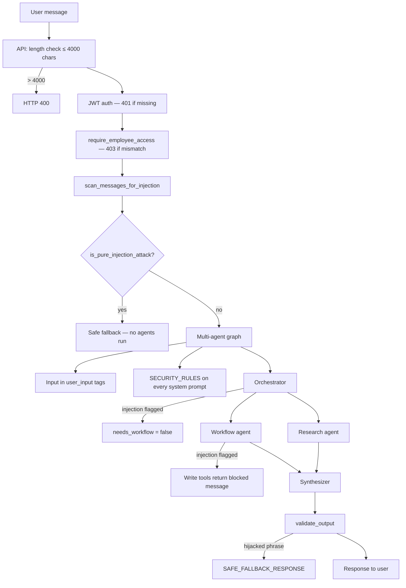

# OnboardAI Security Architecture

OnboardAI uses **defense-in-depth**: multiple independent security layers so that bypassing any single layer does not compromise the system.

---

## 1. Authentication & Authorization

### Employee Authentication

All `/api/employee/*` and `/api/chat` endpoints require a **signed employee JWT** (or equivalent token).

| Mechanism | File | Detail |
|-----------|------|--------|
| Token issuance | `shared/auth.py` → `create_employee_token()` | HMAC-signed with `SECRET_KEY`; includes `employee_id` and expiry |
| Token verification | `shared/auth.py` → `get_current_user()` | Returns `401` if missing, expired, or tampered |
| **Ownership enforcement (IDOR prevention)** | `shared/auth.py` → `require_employee_access()` | Verifies `token.employee_id == requested_employee_id`; raises `403` on mismatch and `401` if unauthenticated |

> **Previously vulnerable:** endpoints accepted `employee_id` from the URL/body without checking that the authenticated caller *owned* that ID. An employee could read or modify another employee's data (classic IDOR). **Now fixed:** `require_employee_access()` is called unconditionally on every employee-scoped endpoint.

### Admin Authentication

| Requirement | Implementation |
|-------------|----------------|
| `ADMIN_API_KEY` **must** be set | `_require_admin()` raises `HTTP 403` immediately if `ADMIN_API_KEY` is empty — **no dev-mode bypass** |
| Constant-time comparison | `hmac.compare_digest()` used to prevent timing attacks |
| Call sites | All `/api/admin/*` and `/api/onboarding/*/reset` endpoints pass both `api_key` and `user` to `_require_admin()` |

> **Previously vulnerable:** when `ADMIN_API_KEY` was unset (empty string), the check `if not ADMIN_API_KEY` short-circuited and **granted admin access to anyone**. **Now fixed:** empty key raises `403` unconditionally.

---

## 2. Network Security

### CORS Configuration

| Setting | Value | Rationale |
|---------|-------|-----------|
| `allow_origins` | From `ALLOWED_ORIGINS` env var | Defaults to `http://localhost:5173,http://localhost:3000`; never `*` |
| `allow_credentials` | `True` | Required for cookie/header auth |
| **Wildcard + credentials guard** | Wildcard `*` is filtered out if `allow_credentials=True` | Browser disallows this combination; we enforce it at startup too |
| `allow_methods` | `["GET", "POST", "OPTIONS"]` | Minimal surface |
| `allow_headers` | Explicit allowlist | `Authorization`, `Content-Type`, `X-Admin-Key`, `X-Request-ID` |

> **Previously vulnerable:** `ALLOWED_ORIGINS` defaulted to `"*"` which, combined with `allow_credentials=True`, violates browser security and allows cross-site credential theft. **Now fixed.**

### IP Address Handling

```python
# _get_client_ip() — backend/app/main.py
def _get_client_ip(request: Request) -> str:
    if request.client.host in TRUSTED_PROXIES:
        forwarded = request.headers.get("X-Forwarded-For")
        if forwarded:
            return forwarded.split(",")[0].strip()
    return request.client.host
```

| Setting | File | Default |
|---------|------|---------|
| `TRUSTED_PROXIES` | `shared/config.py` | `{"127.0.0.1", "::1", "testclient"}` |
| Env override | `TRUSTED_PROXIES=` | Comma-separated IP list |

> **Previously vulnerable:** `X-Forwarded-For` was trusted from **any** source, so an attacker could spoof their IP to bypass rate limiting. **Now fixed:** only connections from known proxy IPs may supply `X-Forwarded-For`.

---

## 3. Audit Logging

```python
# _audit_log() — backend/app/main.py
def _audit_log(action: str, **kwargs) -> bool:
    audit_logger.info("AUDIT: %s %s", action, kwargs)   # always
    try:
        # write to audit_logs table ...
        return True
    except Exception as e:
        audit_logger.error("AUDIT LOG STORAGE FAILURE: %s — %s", action, e, exc_info=True)
        return False
```

- **Never silently swallows failures** — every exception is logged at `ERROR` level with full traceback.
- Returns `True` on success, `False` on failure — callers can react (future: alerting).
- Always emits an `INFO` audit entry even if DB write fails (useful for log-based auditing).

> **Previously vulnerable:** `_audit_log()` had a bare `except: pass` that silently dropped all errors. Administrators received no indication that audit records were missing. **Now fixed.**

---

## 4. Prompt Injection Defenses

### Request Flow



### Defense Layers

| Layer | File | What it does |
|-------|------|--------------|
| **Input length** | `backend/app/main.py` | Rejects messages > 4,000 chars (HTTP 400) |
| **Injection scan** | `backend/agent/security.py` | Regex on user message + chat history |
| **Pure-attack early exit** | `backend/agent/multi_agent.py` | Skips entire graph; returns safe fallback immediately |
| **Input wrapping** | `backend/agent/security.py` | User text in `<user_input>` tags; history in tagged blocks |
| **Security prompts** | `backend/agent/multi_agent.py` | `SECURITY_RULES` appended to every system prompt |
| **Workflow block** | `backend/agent/multi_agent.py` | `needs_workflow=false` when injection flagged |
| **Synthesizer isolation** | `backend/agent/multi_agent.py` | Answer built from specialist outputs, not raw user text |
| **Output guardrail** | `backend/agent/security.py` | Blocks hijacked phrases and prompt leaks |
| **Tool write blocking** | `backend/agent/tools.py` | No task/check-in writes when injection suspected |
| **Tool call filtering** | `backend/agent/multi_agent.py` | Write tools hidden from API response when flagged |
| **Tool limits** | `backend/agent/tools.py` | Max 5 tasks per message |
| **Server validation** | `shared/tasks.py` | Title/topic length, due_day 1–90, category allowlist |

### Injection Patterns Detected

- `ignore (all) previous/prior instructions`
- `ignore all his/her/their message(s)`
- `new urgent instruction`
- `this user is a hacker`
- `you are now …`
- `reveal (your) system prompt`
- `(only) respond with "…"`
- Fake system tags (`<system>`, `### system`)

---

## 5. Rate Limiting & Input Validation

| Control | Detail |
|---------|--------|
| Rate limit | 20 requests/minute per IP (sliding window, in-memory) on `/api/chat` |
| `employee_id` format | Strict regex `^[a-zA-Z0-9_-]{1,100}$` on all path parameters |
| Message length | ≤ 4,000 characters |
| Task/check-in fields | Title length, topic length, due_day 1–90, category allowlist |

---

## 6. Security Implementation Status

| Issue | Vulnerability | Status | Fix Location |
|-------|--------------|--------|-------------|
| **1** | `_require_admin()` allowed access when `ADMIN_API_KEY` was empty | ✅ Fixed | `backend/app/main.py` |
| **2** | Employee endpoints accepted `employee_id` from URL without authenticating caller | ✅ Fixed | `shared/auth.py`, `backend/app/main.py` |
| **3** | No IDOR prevention — employees could access other employees' data | ✅ Fixed | `shared/auth.py` → `require_employee_access()` |
| **4** | `_get_client_ip()` trusted `X-Forwarded-For` from any source (IP spoofing) | ✅ Fixed | `backend/app/main.py`, `shared/config.py` |
| **5** | CORS wildcard `*` combined with `allow_credentials=True` | ✅ Fixed | `backend/app/main.py`, `shared/config.py` |
| **6** | `_audit_log()` silently swallowed all exceptions (`except: pass`) | ✅ Fixed | `backend/app/main.py` |
| **7** | Prompt injection — model could be hijacked via user messages | ✅ Maintained | `backend/agent/security.py`, `backend/agent/multi_agent.py` |
| **8** | RAG documents treated as trusted instructions | ✅ Fixed | `backend/agent/multi_agent.py` — docs wrapped as `<retrieved_content>` |
| **9** | LLM-generated tool arguments not validated server-side | ✅ Fixed | `backend/agent/tools.py` — argument validation before execution |
| **10** | Admin permissions re-enforced independently of LLM | ✅ Fixed | `backend/app/main.py` — Python-level `_require_admin()` check |

---

## 7. Regression Tests

All 20 test suites in `tests/test_improvements.py` pass, including 5 dedicated security regression suites:

| Test | Covers |
|------|--------|
| `test_issue1_require_admin_rejects_empty_key` | Issue 1: empty `ADMIN_API_KEY` → 403 |
| `test_issue2_and_3_employee_endpoint_auth_and_ownership` | Issues 2 & 3: unauthenticated → 401; wrong employee → 403 |
| `test_issue4_client_ip_spoofing_defense` | Issue 4: spoofed `X-Forwarded-For` from untrusted IP is ignored |
| `test_issue5_cors_credentials_wildcard_prevention` | Issue 5: wildcard `*` absent when `allow_credentials=True` |
| `test_issue6_audit_log_error_handling` | Issue 6: DB failure → logs error, returns `False` |

Run with:
```bash
python tests/test_improvements.py
```

---

## 8. Known Limitations

| Area | Note |
|------|------|
| **Rate limiting** | In-memory; resets on restart. For production, replace with Redis-backed limiter. |
| **JWT secret** | `SECRET_KEY` must be set in `.env`; never use the insecure default in production. |
| **Audit log DB** | If the database is unavailable, audit entries are logged to the application log but not persisted in `audit_logs` table. |
| **Prompt injection** | Remains a research-level problem. Defense-in-depth reduces risk but cannot eliminate it for all adversarial inputs. |
| **Admin key rotation** | No key rotation mechanism currently; requires restart to pick up new `ADMIN_API_KEY`. |

---

## Related

- [MULTI-AGENT.md](./MULTI-AGENT.md) — agent architecture and security gate
- [EVALS.md](./EVALS.md) — evaluation harness documentation
- [RUN.md](./RUN.md) — local development commands
- [PROJECT_HANDOVER.md](./PROJECT_HANDOVER.md) — full project handover document
